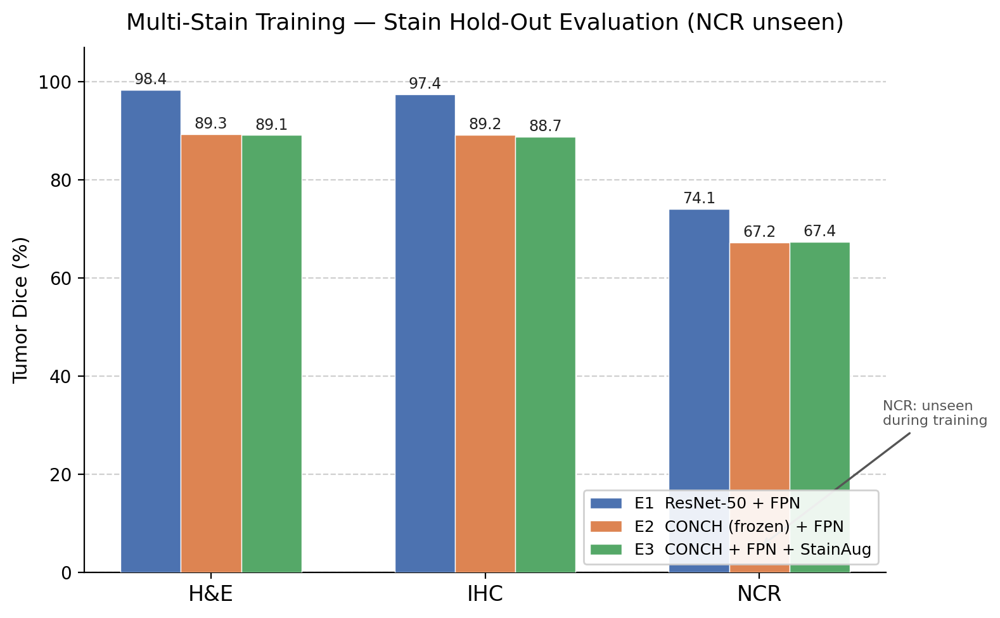

# Domain Generalisation to an Unseen Stain in Medical Image Segmentation

BEng final-year project (XJTLU / University of Liverpool, 2025–26). Can a tumour-segmentation model trained on some stains still work on a stain it has never seen?

Clinical tumour segmentation models usually fail when the staining changes. This project builds a **stain-level holdout benchmark** on a private clinical dataset of paired whole-slide images (H&E, IHC and a third stain, NCR) from five patients, trains on H&E and IHC only, and evaluates on the fully unseen NCR stain.

> The clinical data, patches and trained weights are **not** included in this repository. Only the code and the final evaluation results are published.

## Key results

Tumour Dice (%) on held-out patches. NCR is never seen during training.

| Experiment | Encoder | H&E (seen) | IHC (seen) | **NCR (unseen stain)** |
| --- | --- | --- | --- | --- |
| E1 | ResNet-50 + FPN, fully fine-tuned | 98.36 | 97.44 | **74.08** |
| E2 | CONCH ViT-B/16 (frozen) + FPN | 89.34 | 89.22 | 67.16 |
| E3 | E2 + Macenko-style stain augmentation | 89.10 | 88.75 | 67.39 |

- Training on H&E and IHC reaches 74.08% tumour Dice on the unseen NCR stain, against about 6% when training on H&E only, recovering about 92% of the in-distribution ceiling (80.67% when NCR is included in training). These last numbers come from the project report.
- A fully fine-tuned ResNet-50 + FPN beats the frozen CONCH pathology foundation model by about 7 Dice points on the unseen stain; stain augmentation did not close the gap. Adaptability of the encoder mattered more than pathology-specific pre-training.

Raw evaluation files are in [`results/`](results/); charts are in [`figures/`](figures/).



## What is in this repository

```
configs/      mmsegmentation configs: _base_ plus E1 (ResNet-50), E2 (CONCH), E3 (CONCH + stain augmentation)
models/       CONCH ViT backbone wrapper with a pyramid generator that feeds the FPN decoder
transforms/   stain augmentation in optical-density space (Macenko-style) and mask remapping
data/         whole-slide readers and the patch dataset class
scripts/      patch extraction (affine registration across stains), training, evaluation, plots, SLURM jobs
results/      evaluation JSON for E1, E2 and E3
figures/      result chart and training curves
```

Pipeline: whole-slide images are registered across stains with an affine transform, tissue is cut into 512×512 aligned patches (60,306 patches in total), and a segmentation model is trained on two stains and tested on the third.

## Tech stack

Python, PyTorch, mmsegmentation / mmengine, CONCH (pathology foundation model), OpenSlide, OpenCV, scikit-image, pandas, SLURM.

## Reproducing

The private slides and patch indices cannot be shared, so the experiments cannot be rerun end to end from this repository. To adapt it to your own multi-stain data:

1. `bash setup_env.sh` (or `setup_env.bat` on Windows) to create the environment; clone [CONCH](https://github.com/mahmoodlab/CONCH) separately and run `download_weights.py` (needs access to the CONCH weights).
2. Build a patch index CSV like the ones produced by `scripts/make_v7_csv.py`.
3. Train with `python scripts/02_train.py --config configs/E1_resnet_fpn.py`, then evaluate with `scripts/03_evaluate.py`.

## Notes

- Paths in the configs are placeholders (`/path/to/FYP_S2`); set them for your machine.
- The final experiments were run on university compute. Not all intermediate logs and data were kept, so this repository contains the code and final results rather than full training logs.
- Research code, not a clinical tool.

## Author

Yuyao Wang. Supervisor: Dr Jingxin Liu.
